# OneSearch — Comprehensive African & Nigerian Sector Research Deep Dive

> An exhaustive, data-grounded intelligence dossier examining 18 economic and technological sectors across Nigeria and Sub-Saharan Africa. Detail-driven analysis of structural tailwinds, market sizing, winners, catastrophic failure autopsies, unit economics, regulatory landmines, and identified unexploited market gaps.

---

## Sector Evaluation Matrix Overview

| Sector | Current Macro Status | Risk Profile | Opportunity Score (1–10) | Primary Failure Mode | Proven Winning Moat |
|---|---|---|---|---|---|
| **1. Fintech & Digital Payments** | Maturing / Consolidating | Medium-High | **8.8** | Reliance on pure interchange fees | Physical merchant agency networks & terminal hardware |
| **2. Agritech & Supply Chain** | Struggling / Rebuilding | Critical | **4.2** | Guaranteed-return crowdfunding & biological risk | B2B cold storage infrastructure & physical commodity grading |
| **3. Edtech & Skill Building** | Underperforming | High | **5.1** | B2C video subscription streaming for K-12 | B2B corporate upskilling & high-stakes exam tutoring |
| **4. Healthtech & Pharma Distribution** | Emerging / High-Yield | Medium | **8.4** | B2C standalone telemedicine video apps | B2B wholesale pharmaceutical distribution & working capital |
| **5. Logistics & Freight Transit** | Capital-Heavy Growth | High | **7.5** | Last-mile consumer dispatch in congested traffic | Asset-light freight brokerage & cross-border cargo lines |
| **6. E-Commerce & Social Commerce** | Pivoting / Retrenching | Very High | **4.9** | Cash-on-delivery returns & inventory burn | Social commerce enablement tools (order/catalog management) |
| **7. Energy & Off-Grid Solar** | High Structural Growth | Medium-Low | **9.1** | Unhedged FX debt on residential PAYG kits | Commercial & Industrial (C&I) corporate PPAs with factories |
| **8. Food & Quick-Commerce Delivery** | Hyper-Competitive | Very High | **6.2** | Nationwide expansion with VC meal subsidies | High-density hyper-local clustering & batch routing |
| **9. Mobility & Urban Transit** | High Regulatory Flux | Very High | **5.5** | Arbitrary municipal motorcycle bans & fuel costs | B2B corporate shuttle contracts & EV fleet conversions |
| **10. B2B SaaS & SME Software** | Underrated Growth | Low-Medium | **9.3** | Pricing in USD with complex enterprise setups | Sachetized, mobile-first invoicing & tax compliance tools |
| **11. Media, Entertainment & Nollywood** | Booming Global Reach | Medium | **8.2** | Relying on domestic consumer streaming subscriptions | Global licensing, export royalties & IP distribution |
| **12. Real Estate & Proptech** | Slow / Fragmented | High | **6.0** | Attempting to disintermediate traditional estate agents | Short-let management, title verification & co-living spaces |
| **13. Creator Economy & Digital Goods** | Explosive Micro-Growth | Low | **8.6** | Multi-step international payout frictions | Instant local-currency bank payouts & mobile checkout |
| **14. Fashion & Apparel Retail** | Localized / Bespoke | High | **5.0** | High return rates on mass-produced ready-to-wear | On-demand tailoring networks & export ethnic wear |
| **15. Waste Management & Circular Economy** | Under-Invested / Essential | Medium | **7.8** | Relying entirely on municipal government payments | Industrial scrap off-take contracts & plastic export credits |
| **16. Telecoms, Fiber & Connectivity** | High Infrastructure Moat | Medium | **8.0** | High diesel costs & cell tower fiber vandalism | Last-mile ISP distribution, fixed wireless & Starlink kits |
| **17. Tourism, Hospitality & Short-Stays** | Niche Domestic / Diaspora | Medium-High | **6.7** | Relying on inbound international tourists | Diaspora holiday stays ("Detty December") & corporate retreats |
| **18. Light Manufacturing & FMCG** | High Barrier / High Deficit | High | **8.5** | Raw material FX exposure & power grid outages | Local raw material sourcing & packaging sachetization |

---

## 1. Fintech & Digital Payments

### Sector Status
**Maturing / Consolidating (Tier-1 African Tech Sector)**

### Macro Market Sizing & Data Points
- **Total Payment Volume (TPV) in Nigeria (2023):** Over ₦600 trillion processed across NIBSS Instant Payment (NIP) rails.
- **Adult Financial Inclusion:** 64% formally included (EFInA 2023), up from 56% in 2020.
- **Active Point-of-Sale (POS) Terminals:** Over 2.7 million deployed terminals across the 36 states and FCT.
- **Venture Capital Concentration:** Received over $1.2 billion between 2021 and 2023, representing >55% of all equity invested in Nigerian startups.

### Notable Players & Outcomes
- **Winners:**
  - **Paystack:** Acquired by Stripe for $200M+ in 2020. Dominated online developer-first payment checkout. Built rock-solid API uptime and seamless merchant settlement.
  - **Moniepoint (formerly TeamApt):** Reached unicorn status ($1B+ valuation) in 2024. Pivoted from enterprise banking software to offline merchant POS acquiring and working capital loans. Processes over $17 billion monthly TPV.
  - **Opay & PalmPay:** Backed by Chinese capital and opera distribution. Won mass-market consumer banking and agent dominance through zero-fee P2P transfers, high agent float subsidies, and proprietary offline infrastructure during the 2023 cash crunch.
- **Struggling / Casualties:**
  - **Lidya:** Raised $10M+ for SME digital lending. Closed Nigerian operations in 2023 to pivot to Eastern Europe due to unmanageable SME loan default rates and currency depreciation.
  - **Kippa:** Raised $8M+ for SME bookkeeping. Shut down its Kippa Pay agency banking product in 2023 and laid off 40+ staff due to unsustainable POS hardware subsidy costs and razor-thin payment margins.
  - **Dash:** Ghanaian-Nigerian cross-border payments app. Raised $85M+. Collapsed in 2023 amidst widespread financial fabrication, executive fraud, and fabricated user numbers.

### Deep Dive: Why the Winners Won
1. **Offline Hardware Supremacy:** Moniepoint and Opay understood that Nigerian commerce is 90% offline. Rather than waiting for consumers to download smartphone apps, they deployed orange and blue POS terminals into every street corner kiosk, capturing daily transactional cash-flow.
2. **Infrastructure-Level Reliability:** Opay built direct clearing integrations that achieved a 99.8% transaction success rate during the CBN Q1 2023 currency redesign cash crunch, when legacy commercial banks (GTCO, Zenith, Access) experienced 40%+ failure rates.
3. **Multi-Product Merchant Monetization:** Moniepoint did not survive on 0.5% POS transaction fees alone; they leveraged transaction data to cross-sell merchant overdrafts, working capital loans, and commercial business accounts.

### Why Failures Failed (Root Causes)
1. **Uncollateralized Nano-Lending Defaults:** Standalone digital lending apps offering ₦10,000 to ₦50,000 instant loans via mobile apps suffered default rates of 25–40%. As living costs spiked, borrowers discarded SIM cards and deleted apps. Predatory debt-shaming contacts damaged public trust and triggered severe FCCPC regulatory crackdowns.
2. **Hardware Subsidy Bleed:** Companies giving free POS terminals to merchants without enforcing daily minimum volume thresholds burned millions in capex as merchants kept terminals inactive or used competitors' machines.
3. **The Card Interchange Delusion:** Silicon Valley investors funded startups assuming Visa/Mastercard 2–3% interchange margins existed in Nigeria. In reality, domestic NIBSS transactions operate on capped, fractional basis points, rendering consumer interchange revenue negligible.

### Unit Economics Breakdown: Digital POS Terminal
- Hardware procurement cost (Android Smart POS): ₦85,000 – ₦110,000.
- Monthly transaction volume required to break even on hardware: ₦3,500,000.
- Gross fee per transaction: 0.5% (capped at ₦100 per transaction).
- Net operator take-home after NIBSS and switching fees: ~0.15% (₦15 on a ₦10,000 withdrawal).
- Real profit driver: Merchant lending at 3.5%–5% monthly interest based on terminal transaction velocity.

### Regulatory Landmines
- **CBN Licensing Tiers:** Strict segregation between PSSP (₦100M capital), Payment Terminal Service Provider (PTSP), and Mobile Money Operator (MMO - ₦2B capital).
- **KYC Compliance Escalation:** Stricter Tier-1 account restrictions requiring mandatory BVN (Bank Verification Number) and NIN (National Identity Number) linkage, eliminating anonymous burner wallets.

### Unexploited Market Gaps
- **Cross-Border AfCFTA Settlement for Informal Traders:** Frictionless currency conversion and instant payment rails between Nigeria, Ghana, Benin Republic, and Côte d'Ivoire for WhatsApp/Instagram merchants.
- **Automated Tax Compliance Infrastructure:** Software helping micro-merchants automatically withhold and remit state withholding taxes and VAT without accounting complexity.

---

## 2. Agritech & Supply Chain

### Sector Status
**Struggling / Rebuilding (Extreme Caution Required)**

### Macro Market Sizing & Data Points
- **Contribution to Nigerian GDP:** 22%–24% of national GDP (NBS Q2 2024).
- **Labor Force Absorption:** Employs over 36% of the national workforce, predominantly in subsistence smallholding.
- **Post-Harvest Food Losses:** Over 40% of fresh fruits and vegetables perish prior to consumption (valued at over $9 billion annually).
- **Agricultural Import Bill:** Exceeds $2 billion annually for wheat, dairy, and edible oils despite arable land abundance.

### Notable Players & Outcomes
- **Winners / Sustainable Operators:**
  - **AFEX Commodities Exchange:** Reached profitability and institutional scale. Built private grain silos, certified electronic warehouse receipts, and physical commodity grading labs. Securitized agricultural yields for institutional debt financing.
  - **Hello Tractor:** "Uber for tractors" asset-sharing software. Expanded across Nigeria, Kenya, and India by partnering with John Deere and commercial banks to finance equipment for tractor entrepreneurs, avoiding balance-sheet equipment ownership.
  - **ColdHubs:** Solar-powered walk-in cold rooms deployed directly in open food markets (Mile 12, Bodija). Charges ₦200 per 20kg crate per night, extending vegetable shelf-life from 2 days to 21 days with 100% organic cash flow.
- **Catastrophic Failures:**
  - **Farmcrowdy:** The pioneer of Nigerian digital agriculture crowdfunding. Raised millions, promised 15%–25% returns to retail investors to sponsor poultry and cassava farms. Collapsed into insolvency when weather failures, COVID lockdowns, and bird flu outbreaks wiped out harvests without insurance liquidity.
  - **Thrive Agric:** Fast-growing agritech platform. Defaulted on billions of Naira in retail crowdsourced debt obligations in 2020 following off-taker payment delays and crop failures. Rescued via emergency institutional debt restructuring by Sahel Capital and Ventures Platform, pivoting entirely away from retail crowdfunding.
  - **Agropartnerships & FarmSponsor:** Ponzi-like retail agritech schemes that promised 30%+ guaranteed returns. Collapsed in 2021–2022, resulting in SEC bans and founder arrests.

### Detailed Case Study: The Crowdfunded Agritech Implosion
In 2017–2019, Nigerian urban professionals sought inflation-beating yields. Platforms like Farmcrowdy and Thrive Agric offered "digital farming": sponsor a poultry unit for ₦50,000 and receive 20% interest in 6 months. 
- **The flaw:** Agriculture is biological. A single Newcastle disease wave kills 10,000 birds in 48 hours. When crops failed, startups could not repay retail sponsors. To avoid bad PR, many used incoming sponsorships from new cycles to pay maturing debts of previous cycles — the textbook definition of a Ponzi cycle under stress.
- **The lesson:** Biological and weather risks cannot be wrapped in guaranteed fixed-income promises without institutional parametric insurance.

### Structural Market Gaps
- **Decentralized Solar Cold Storage:** Replicating ColdHubs models for tomato, pepper, and onion corridors in Kano, Kaduna, and Plateau states.
- **Parametric Micro-Insurance:** Satellite-indexed crop insurance that automatically triggers payouts based on verified rainfall deficits, protecting smallholders without manual physical claims adjusters.

---

## 3. Edtech & Skill Building

### Sector Status
**Underperforming / Pivoting toward Enterprise & Vocational**

### Macro Market Sizing & Data Points
- **Demographic Pressure:** Over 105 million Nigerians under the age of 18; 20+ million out-of-school children (UNICEF).
- **Public Tertiary Breakdown:** Chronic academic shutdowns (ASUU strikes averaging 6 months every two years).
- **Average Monthly Household Ed Spend:** 12%–18% of household income spent on private school fees and supplementary tutoring.
- **Hardware Barrier:** Smartphone penetration among primary school pupils is under 15%; shared parent phones dominate.

### Notable Players & Outcomes
- **Winners / Sustainable Operators:**
  - **uLesson:** Raised $25M+. Initially built pure video streaming apps for K-12 students. Pivoted to selling bundled hardware tablets with pre-loaded offline SD cards, and later launched "Class54" for computerized JAMB/WAEC practice, and physical learning hubs in Abuja and Lagos.
  - **AltSchool Africa:** Software engineering and product vocational school. Successfully bypassed local low-fee caps by enrolling students across multiple African countries, charging affordable monthly tuition installments, and partnering with international placement agencies.
  - **Tuteria:** Offline home-tutor marketplace connecting verified educators with wealthy parents for 1-on-1 exam prep. Maintained profitable cash-flows by charging commission on human tutor placement rather than selling standalone digital content.
- **Struggles & Stagnation:**
  - **Prepclass:** Early leader in digital tutoring. Scaled down software operations due to heavy customer acquisition costs and low student retention on self-paced video courses.
  - **Gradely:** AI-powered student assessment tool. Encountered high sales cycles and payment delays when selling SaaS directly to private school proprietors.

### Why Winners Won vs Why Failures Failed
1. **The Data Cost Barrier in B2C Streaming:** Asking a Nigerian parent earning ₦150,000/month to purchase a ₦10,000/month video streaming course PLUS 10GB of mobile data (₦6,000) for video playback was an economic non-starter. Successful platforms (uLesson) pre-loaded content onto physical memory cards or deployed zero-rated text-based learning.
2. **Outcome-Driven Spend:** Nigerian parents do not pay for "conceptual enrichment"; they pay for certified high-stakes outcomes: passing JAMB, WAEC, IELTS, or learning coding to secure an offshore USD remote job. Edtech targeting general curiosity consistently fails.
3. **Private School ERP Churn:** Selling software to private K-12 school owners suffers from 35% churn during term holidays (July–September) as proprietors cancel subscriptions to conserve cash when school fees stop flowing.

### Unit Economics of Private Tutoring vs SaaS
- Average parent monthly spend on in-person home tutor (Lagos/Abuja): ₦40,000 – ₦80,000.
- Willingness to pay for an automated mobile learning app: ₦2,000 – ₦3,500.
- Tutor marketplace commission take-rate: 20%–25% (yielding ₦10,000–₦20,000 net margin per student per month with zero video bandwidth costs).

### High-Opportunity Market Gaps
- **Vocational Micro-Credentials for Informal Artisans:** Digital certification and apprenticeship verification for electricians, plumbers, and solar technicians linked to guaranteed corporate contracting jobs.
- **WhatsApp-Delivered Micro-Tutoring:** Automated conversational quiz engines on WhatsApp for secondary school exam prep, eliminating app download resistance and data overhead.

---

## 4. Healthtech & Pharma Distribution

### Sector Status
**Emerging / High-Yield (B2B Dominant)**

### Macro Market Sizing & Data Points
- **Out-of-Pocket Healthcare Financing:** 72% of total national health spend is paid in cash at point of care.
- **Health Insurance Penetration:** <4.5% of the total population covered by any formal HMO or NHIS scheme.
- **Counterfeit Pharmaceutical Rate:** 20%–35% of circulating medication in unregulated wholesale markets fails chemical purity assays.
- **Physician-to-Patient Ratio:** 1 doctor per 5,000 patients (WHO benchmark: 1 per 600), worsened by severe medical brain drain ("Japa" phenomenon).

### Notable Players & Outcomes
- **Winners:**
  - **LifeBank:** Pioneered asset-light, cold-chain emergency medical logistics. Delivers blood, oxygen, and rare vaccines to hospitals within 45 minutes using motorbikes and boats. Sustained via B2B hospital billing, government partnerships, and zero reliance on impoverished consumer out-of-pocket payments.
  - **Helium Health:** Reached market leadership in hospital electronic medical records (EMR) across West Africa. Deployed hybrid offline-first local network software that functions seamlessly during power outages and internet downtime. Expanded into hospital invoice factoring and credit.
  - **Remedial Health & Field Intelligence:** Digitized the fragmented wholesale pharmacy supply chain. Supplies verified medications directly to community pharmacies and patent medicine vendors (PPMVs) with 30-day buy-now-pay-later (BNPL) inventory financing.
- **Struggling / Casualties:**
  - **54gene:** Raised $45M+ to build Africa’s largest human genomic biobank. Collapsed into liquidation in 2023 amidst executive leadership churn, governance disputes, excessive capital expenditure on lab robotics, and the end of COVID testing revenue.
  - **Direct Consumer Telemedicine Apps:** Numerous early apps offering $15 video doctor calls shut down or pivoted to physical clinics; patients refused video triage without physical palpation and on-site lab tests.

### Winning Playbook vs Fatal Flaws
- **B2B Infrastructure Over B2C Apps:** Doctors and pharmacies have established daily cash-flow and severe procurement pain points. Solving drug counterfeit risk and offering inventory credit creates a defensible, sticky moat.
- **Offline-First Software Architecture:** Building cloud-only software for African hospitals is fatal. Hospital receptionists and nurses revert to paper notebooks the moment the fiber cable is cut or the generator runs out of diesel.
- **Avoiding Bio-Tech Capex Traps:** Heavy medical machinery requires imported spare parts, stable electricity, and imported liquid reagents priced in USD. In a devaluing currency environment, capital depreciation overwhelms venture margins.

---

## 5. Logistics & Freight Transit

### Sector Status
**Capital-Heavy Growth / High Infrastructure Moat**

### Macro Market Sizing & Data Points
- **Freight Movement:** Over 90% of all domestic freight in Nigeria moves via roads; rail infrastructure handles under 3%.
- **Port Congestion:** Apapa and Tin Can Island ports in Lagos historically imposed 14–28 day container dwell times, adding $1,000+ per container in demurrage and haulage surcharges.
- **Diesel Fuel Inflation:** Automotive Gas Oil (diesel) jumped from ₦280/L in 2021 to over ₦1,300/L in 2024, altering long-haul freight economics.

### Notable Players & Outcomes
- **Winners:**
  - **GIG Logistics (GIGL):** The undisputed domestic leader in parcel logistics. Leveraged decades of physical bus route infrastructure, company-owned regional hubs, and a proprietary digital tracking app. Built trust through guaranteed delivery and corporate enterprise SLAs.
  - **Kobo360:** Asset-light freight digital brokerage. Connects heavy truck owners with large FMCG manufacturers (Dangote, Unilever, Lafarge). Managed logistics through driver apps, trip tracking, and driver working capital advances.
- **Struggles / Pivots:**
  - **Sendy:** Kenyan-Nigerian logistics marketplace. Raised $25M+. Collapsed into administration and asset liquidation in 2023 after running out of capital to subsidize long-haul truck drivers in a high-interest-rate environment.
  - **Jumia Logistics:** Transitioned from serving purely internal Jumia e-commerce to offering third-party logistics (3PL) to external merchants to amortize warehouse and sorting center overhead.

### Root Cause of Failures in Last-Mile Delivery
1. **Lagos Spatial Economics & Harassment:** Independent dispatch riders spend up to 20% of their working hours stopped at informal police, local government, and union checkpoints paying cash tolls. Breakdowns on potholed roads destroy motorbike lifespans within 18 months.
2. **Reverse Logistics Costs on Failed Deliveries:** When an e-commerce customer rejects an item or does not pick up phone calls upon arrival, the logistics firm absorbs double fuel expenditure with zero revenue collected.

---

## 6. E-Commerce & Social Commerce

### Sector Status
**Pivoting / Retrenching (General Retail E-Commerce is Dead)**

### Macro Market Sizing & Data Points
- **E-Commerce Share of Retail:** Formal online e-commerce accounts for less than 1.5% of total retail trade in Nigeria.
- **Social Commerce Share:** Informal commerce across WhatsApp, Instagram, and TikTok is estimated at 5x the scale of centralized websites.
- **Cash-on-Delivery (COD) Rate:** Historically 65%–70% of online orders, dropping only as merchants outright refuse to ship without advance delivery fee deposits.

### Notable Players & Outcomes
- **The Giants:**
  - **Jumia:** Africa’s "Amazon". Listed on NYSE in 2019. Incurred over $1 billion in cumulative losses. Closed operations in several African countries, shut down Jumia Food, eliminated unessential categories, and downsized workforce to finally reach near-breakeven in 2024.
  - **Konga:** Acquired by Zinox Technologies in 2018 for a fraction of invested capital. Survived by blending online operations with 30+ physical retail stores and direct enterprise hardware distribution.
- **Social Commerce Tooling (The Thriving Model):**
  - **Selar:** Bootstrapped, profitable creator e-commerce storefront. Powers digital product, course, and ticket sales for 100,000+ African creators. Charges low transaction fees with instant bank payouts.
  - **Bumpa & Catlog:** Storefront and inventory management tools for Instagram and WhatsApp sellers. Enables micro-businesses to generate invoices, accept Paystack payments, and manage order status without maintaining complex websites.

### The Fatal Flaw of Traditional B2C E-Commerce in Nigeria
- You cannot run an asset-heavy Amazon warehouse model in an economy where the median purchase value is ₦4,500 ($3.00), the cost of delivery is ₦2,000, and 30% of buyers cancel orders upon arrival because their money was spent elsewhere while waiting for delivery.
- **The Winning Formula:** Lightweight social commerce enablement tools that charge SaaS or micro-transaction fees on sellers who already have their own loyal Instagram/WhatsApp audiences.

---

## 7. Energy & Off-Grid Solar

### Sector Status
**High Structural Growth / The Most Defensible Real-Economy Play**

### Macro Market Sizing & Data Points
- **Centralized Grid Capacity:** Generates 3,500–4,500 MW for 220 million people (South Africa generates 45,000 MW for 60 million people).
- **Private Fossil Fuel Generation:** Over 14 million small generators burning over $14 billion in petrol and diesel annually.
- **Post-Fuel Subsidy Reality:** Petrol price increased from ₦195/L to ₦1,000+/L in 2023–2024, slashing the payback period for a residential 1kVA–3kVA solar system from 4 years to under 11 months.

### Notable Players & Outcomes
- **Winners:**
  - **Starsight Energy & Daystar Power:** Focused strictly on B2B Commercial & Industrial (C&I) solar. Installs rooftop solar arrays on commercial banks (Stanbic, Access), telecom towers, and manufacturing facilities under 10–15 year Power Purchase Agreements (PPAs) with inflation-indexed or USD-linked tariffs. Daystar was acquired by oil major Shell in 2022.
  - **Rensource Energy:** Pivoted from urban solar micro-utilities in open markets to developing massive utility-scale C&I solar power plants for industrial manufacturing clusters.
- **Struggling / Restructuring:**
  - **Lumos Nigeria:** Distributed rooftop solar kits bundled with MTN airtime billing. Suffered severe operational strain from currency devaluation (importing panels in USD, collecting payments in devalued NGN) and battery replacement cost inflation.

### The Golden Rule of Nigerian Solar Energy
- **Do NOT lend to poor households in local currency using foreign-currency debt.**
- **DO install solar for commercial enterprises (supermarkets, banks, hospitals, telecom towers) who are already burning ₦2M–₦20M in monthly diesel bills and have verifiable bank-grade cash-flows.**

---

## 8. Food & Quick-Commerce Delivery

### Sector Status
**Hyper-Competitive / Hyper-Local Survival Game**

### Macro Market Sizing & Data Points
- **Daily Food Spend:** Urban Nigerians allocate 55%–60% of total household income to food and groceries.
- **Restaurant Density:** Clustered heavily in high-income neighborhoods (Lekki, Ikoyi, Victoria Island, Ikeja GRA, Maitama).

### Notable Players & Outcomes
- **Winners:**
  - **Chowdeck:** Founded by former Paystack engineers. Raised seed capital and achieved over ₦1 billion in monthly GMV. Won through hyper-dense clustering in Lagos food epicenters, building proprietary courier routing algorithms, and cultivating high social media brand affinity among Gen-Z urban professionals.
  - **Eden Life:** Began as a meal subscription and home concierge service. Pivoted to focus heavily on "Homemade by Eden Life" (owning the kitchen and food production margin) to capture full food-prep margins rather than pure third-party logistics delivery fees.
- **Defeated Giants:**
  - **Jumia Food:** Shut down across all African markets in December 2023 after continuous multi-million dollar annual losses and inability to achieve unit profitability.
  - **Bolt Food:** Exited Nigerian operations in December 2023 citing severe macroeconomic headwinds and hyper-competitive delivery market dynamics.

### Why Chowdeck Succeeded Where Global Giants Exited
1. **No Phantom Subsidies:** Chowdeck charged honest, cost-reflective delivery fees and service markups from day one, refusing to burn venture capital subsidizing ₦500 deliveries across gridlocked bridges.
2. **Batch Order Optimization:** Couriers pick up multiple orders from adjacent restaurants in single shopping plazas, dramatically increasing driver daily drop-off counts.

---

## 9. Mobility & Urban Transit

### Sector Status
**High Regulatory Flux / Transitioning to Electric & B2B**

### Macro Market Sizing & Data Points
- **Daily Commutes in Lagos:** Over 20 million passenger trips made daily, predominantly in yellow commercial minibuses (Danfos).
- **Fuel Price Shock:** Petrol price quadrupled in 2023–2024, rendering traditional 1.8L–2.4L passenger car ride-hailing unviable for drivers operating on standard 20% platform commission rates.

### Notable Players & Outcomes
- **Winners:**
  - **Shuttlers:** B2B corporate bus-pooling platform. Employers sponsor comfortable air-conditioned bus seats for employees commuting along fixed Lagos routes. High retention, predictable B2B monthly invoices, and insulated from fuel spot-price volatility.
  - **MAX.ng (Mobility Algorithmic Xperience):** Survived the 2020 Lagos okada ban by pivoting into asset financing, electric two-wheelers, and electric three-wheelers with proprietary battery-swapping stations.
- **Failures / Casualties:**
  - **Gokada:** Raised $5M+ for green-helmet motorcycle ride-hailing. Crushed overnight in February 2020 by the Lagos State Government executive okada ban on state highways. Pivoted to logistics, but suffered tragic leadership loss and eventually filed for insolvency/acquisition.
  - **Uber & Bolt Drivers:** Widespread driver discontent, frequent informal strikes, and app-switching as fuel costs erased net driver earnings.

### Primary Regulatory Threat
- **Unilateral Municipal Decrees:** State governments and transport unions can ban vehicle classes or impose new operating licensing levies with zero legislative notice. Any transport business dependent on a single vehicle type or municipal jurisdiction carries extreme sovereign risk.

---

## 10. B2B SaaS & SME Software

### Sector Status
**Underrated Growth / The Highest Capital-Efficiency in Africa**

### Macro Market Sizing & Data Points
- **SME Landscape:** Over 39 million micro, small, and medium enterprises (MSMEs) in Nigeria (SMEDAN 2022).
- **Formal Software Penetration:** Under 3% of Nigerian MSMEs use any formal accounting or ERP software beyond physical exercise books and WhatsApp.

### Notable Players & Outcomes
- **Winners:**
  - **Mono & Okra:** Open banking API infrastructure. Enables fintechs and lenders to retrieve real-time bank statements and initiate direct account-to-account debits.
  - **Duplo:** B2B payment automation and digital invoicing platform for large consumer goods distributors and corporate finance teams.
  - **SeamlessHR:** Enterprise HR, payroll, and recruitment software serving medium-to-large African enterprises. Billed in annual enterprise contracts with high switching costs and near-zero churn.
- **Struggles:**
  - **Micro-SME Free Bookkeeping Apps:** Early apps that raised venture capital to give "free bookkeeping" to roadside vegetable sellers failed to convert users into paying software subscribers.

### Why Enterprise/Mid-Market SaaS Wins
- Target companies with 20 to 500 employees. They experience acute payroll, tax withholding (PAYE), and vendor invoicing headaches. They have formal banking accounts, pay annually via bank transfer, and do not churn over a ₦50,000 price adjustment.

---

## 11. Media, Entertainment & Nollywood

### Sector Status
**Booming Global Reach / Domestic Monetization Paradox**

### Macro Market Sizing & Data Points
- **Nollywood Output:** Produces over 2,500 movies annually, ranking second globally by volume.
- **Global Streaming Inflow:** Netflix and Amazon Prime Video entered Nigeria, investing tens of millions of dollars in original Nollywood commissions.
- **Streaming Music Surge:** Afrobeats achieved billions of Spotify and Apple Music streams globally (Burna Boy, Wizkid, Asake, Rema).

### Structural Reality
- **Domestic Consumer Streaming Doesn't Pay:** Local consumers share passwords or download content via local Wi-Fi sharing hubs (Xender). Domestic subscription ARPU is under $2.50/month.
- **The Winning Strategy:** Produce authentic local cultural content at low local Naira production costs, but monetize via global streaming licensing deals (Netflix, Showmax) paid in hard foreign currency (USD).

---

## 12. Real Estate & Proptech

### Sector Status
**Slow / Fragmented / Asset-Heavy**

### Macro Market Sizing & Data Points
- **Housing Deficit:** Estimated 20–28 million unit housing shortage across urban Nigeria.
- **Upfront Rent Norm:** Landlords in Lagos and Abuja legally or customarily demand 1 to 2 years of upfront rent cash payments.

### Notable Players & Outcomes
- **Struggles of "Monthly Rent" Apps:** Startups that raised VC to pay landlords one year upfront while collecting monthly rent from tenants suffered severe balance-sheet strain. When macroeconomic inflation hit, tenant default rates spiked, leaving the proptech holding unrecoverable rental debt.
- **What Actually Works:** Co-living spaces for tech professionals (scarcity of clean, generator-powered accommodation), short-let serviced apartments for diaspora visitors, and automated digital land title search software.

---

## 13. Creator Economy & Digital Goods

### Sector Status
**Explosive Micro-Growth / Highly Profitable Niches**

### Macro Market Sizing & Data Points
- **Youth Internet Users:** 40+ million active social media accounts in Nigeria.
- **Creator Landscape:** Hundreds of thousands of creators selling e-books, design templates, coaching sessions, comedy skits, and exclusive communities.

### Winning Playbook: The Selar Model
- Selar bypassed the "content consumer subscription" trap. Instead of trying to charge viewers, they built the merchant infrastructure for creators. Creators upload their digital files, share a Selar link on Instagram or Twitter bio, and collect instant payments from fans in 8 African currencies, USD, and GBP, with Paystack handling seamless settlement.

---

## 14. Fashion & Apparel Retail

### Sector Status
**Localized / Bespoke / Severe Logistics Friction**

### The Structural Barrier
- Ready-to-wear e-commerce stores fail because standardized international sizing (UK 10, US M) does not match diverse African body proportions. Return rates hit 35%+.
- **The Winning Model:** Local fabric procurement and bespoke tailoring networks managed via WhatsApp, coupled with export-focused online fashion lines targeting high-income Nigerian diaspora communities in the UK, US, and Canada.

---

## 15. Waste Management & Circular Economy

### Sector Status
**Under-Invested / Essential Municipal Infrastructure**

### Macro Realities
- Lagos generates over 13,000 metric tons of municipal solid waste daily; less than 12% is formally recycled.
- **Pioneering Model: Wecyclers:** Incentivizes low-income households to sort recyclable plastics and aluminum cans using SMS-based reward points redeemable for household essentials. Sells aggregated, cleaned plastic flakes directly to industrial manufacturing recycling plants and global packaging off-takers.

---

## 16. Telecoms, Fiber & Connectivity

### Sector Status
**High Capital Moat / Structural Infrastructure**

### Macro Landscape
- Dominated by MTN Nigeria (40% market share) and Airtel Nigeria.
- **The Starlink Disruption:** SpaceX Starlink launched in Nigeria in 2023. Despite hardware kit costs (~₦450k–₦600k), tens of thousands of remote professionals, tech hubs, and rural schools purchased kits to bypass unreliable local telco cell towers.
- **Opportunity:** Installing and managing Starlink community Wi-Fi relays in underserved towns and commercial office parks.

---

## 17. Tourism, Hospitality & Short-Stays

### Sector Status
**Seasonal / Diaspora Dependent ("Detty December")**

### The Market Cadence
- Inbound foreign tourism is negligible due to visa delays and global security advisories.
- **The Diaspora Goldmine:** Over 100,000 affluent Nigerians in the diaspora visit Lagos, Abuja, and Enugu between December 15 and January 10 every year ("Detty December"). Short-let luxury apartment rental yields during this 4-week window can generate up to 40% of an apartment's annual rental revenue.

---

## 18. Light Manufacturing & FMCG

### Sector Status
**High Barrier / Extreme Import Substitution Opportunity**

### The Strategic Imperative
- The continuous devaluation of the Naira made importing finished consumer packaged goods unaffordable for 90% of the population.
- **The Opportunity:** Local manufacturing of household cleaning chemicals, processed tomato paste, animal feeds, and packaging using 100% locally sourced raw materials. Companies that substitute imports with local production operate with expanding gross margins and zero FX exposure.

---

## The Founder's Sector Decision Heuristic

Before building a product in Nigeria or Sub-Saharan Africa, run your business idea through the following 5-point gatekeeper test:

```
[Question 1] Does the customer already spend physical cash on this problem today?
├── NO  ──> REJECT IDEA (Creating new spending habits in a high-inflation market fails)
└── YES ──> Proceed to Question 2

[Question 2] Are you relying on recurring monthly card debits from consumers?
├── YES ──> HIGH RISK (40%+ debit failure rate on domestic cards; switch to one-time / PAYG)
└── NO  ──> Proceed to Question 3

[Question 3] Are your operating expenses (SaaS, hosting, equipment) denominated in USD while revenue is in NGN?
├── YES ──> CRITICAL FX EXPOSURE (A single devaluation wipes out gross margin)
└── NO  ──> Proceed to Question 4

[Question 4] Can a municipal transport union, local council, or CBN circular make your business illegal overnight?
├── YES ──> REGULATORY FRAGILITY (Must secure state backing or diversify asset dependencies)
└── NO  ──> Proceed to Question 5

[Question 5] Does value delivery require physical moving parts (bikes, trucks, cold rooms)?
├── YES ──> UNIT ECONOMICS CHECK (Must charge realistic cost-reflective delivery fees from Day 1)
└── NO  ──> HIGH CAPITAL EFFICIENCY (Software, B2B tooling, digital assets)
```

---

## Detailed Failure Mode Taxonomy

```mermaid
graph TD
    A[African Startup Failures] --> B[Macroeconomic Shocks]
    A --> C[Business Model Misalignments]
    A --> D[Regulatory & State Interventions]
    A --> E[Operational & Infrastructure Breaches]

    B --> B1[Currency Devaluation / USD Cloud Costs]
    B --> B2[Household Disposable Income Collapse]
    B --> B3[Fuel Subsidy Removal Logistics Shock]

    C --> C1[Silicon Valley Playbook Cloning]
    C --> C2[Guaranteed Returns on Biological Assets]
    C --> C3[Consumer Subscription Inelasticity]
    C --> C4[Vanity GMV vs Real Gross Margin]

    D --> D1[Overnight Vehicle Class Bans]
    D --> D2[Central Bank Crypto & Remittance Circulars]
    D --> D3[Informal Union & Local Council Multiple Levies]

    E --> E1[Cold-Chain Breaks & Post-Harvest Losses]
    E --> E2[Cash-on-Delivery Cancellations & Theft]
    E --> E3[Grid Outages & Diesel Generator Overheads]
```



---

## Synthesis: The OneSearch Golden Rules for Building in Africa

1. **If Your Revenue is in Naira, Your Costs Must Be in Naira:** Any startup paying AWS server bills in USD and charging consumers ₦1,500/month in NGN will eventually go bankrupt when the currency depreciates.
2. **Target Businesses, Not Indigent Consumers:** Selling luxury subscriptions to consumers with zero disposable income is impossible. Sell cost-reduction, revenue-generation, or inventory tools to businesses that already have daily cash collections.
3. **Hardware & Physical Distribution Defeats Software-Only Plays:** The biggest African tech winners (Opay, Moniepoint, LifeBank, ColdHubs, AFEX) all integrated physical operations, hardware terminals, or boots-on-the-ground agents.
4. **Price for the African Reality (Sachetize or One-Time):** Recurring monthly bank debits fail over 40% of the time in Nigeria. Offer low-friction one-time payments (such as OneSearch's ₦2,000 pro unlock) or micro-transactions linked to instant value delivery.
5. **Research Authenticity Over AI Synthetics:** Never rely on generic AI models to understand how a dispatch rider in Oshodi navigates local agbero tickets or how a pharmacy in Onitsha buys cefuroxime. Deep empirical ground-truth is the only sustainable competitive advantage.

---

*This research dossier represents proprietary field investigations, industry financial filings, regulatory releases, and macroeconomic studies curated by the OneSearch founder. For full essays, ongoing field interviews, and weekly sector teardowns, subscribe to the founder's Substack referenced in the platform footer.*


---

## Detailed TAM vs SAM vs SOM Realities in Nigeria

Many founders present pitch decks asserting: *"Nigeria has 220 million people. If only 1% pay us ₦2,000/month, we make ₦4.4 billion ARR."*
This is the single most common statistical fallacy in emerging markets venture creation. The following table provides the realistic funnel haircut required when evaluating total market size:

```
[Layer 1] Total Nominal Population: 220,000,000
   │
   ▼ (Haircut: 53% are under 19 years old or over 65)
[Layer 2] Working-Age Population: ~105,000,000
   │
   ▼ (Haircut: 63% multidimensionally poor; lack disposable buffer)
[Layer 3] Economically Active Population with Discretionary Income: ~38,000,000
   │
   ▼ (Haircut: Only 40% own personal 4G/5G smartphones with active data)
[Layer 4] Digitally Accessible Solvent Consumers: ~15,000,000
   │
   ▼ (Haircut: Clustered primarily in Lagos, Abuja, Port Harcourt, Ibadan, Kano)
[Layer 5] True Addressable Urban Tech Consumer Pool: 4,000,000 – 6,000,000
   │
   ▼ (Haircut: Early-adopter willingness-to-pay conversion rate ~2%–5%)
[Layer 6] Realistic Serviceable Obtainable Market (SOM): 80,000 – 300,000 users
```

When building consumer apps, founders must model their unit economics around a realistic SOM of 100,000 to 250,000 paying users, NOT 220 million people. At ₦2,000 one-time fee across 100,000 serious builders/operators, OneSearch targets a high-conviction ₦200,000,000 ($130,000 USD) cash flow baseline without venture bloat.

---

## Final Checklist for Founders Pre-Launch

Before writing code or registering an entity with CAC (Corporate Affairs Commission):

1. **Verify offline alternatives:** Have you visited the physical market (Computer Village, Balogun, Mile 12, Ladipo) to observe how merchants solve this problem without software?
2. **Calculate diesel/fuel sensitivity:** If petrol rises another 50%, does your customer or delivery fleet go bankrupt?
3. **Audit payment UX:** Can a customer pay in under 15 seconds without being redirected across three separate banking apps?
4. **Stress test FX sensitivity:** If the US Dollar appreciates by 30% against the Naira, do your server hosting, domain renewals, or tool subscriptions turn your company insolvent?
5. **Evaluate switching costs:** Why won't your customer simply switch to a free WhatsApp group or an Excel spreadsheet next week?

---

*End of Comprehensive Sector Intelligence Dossier.*
